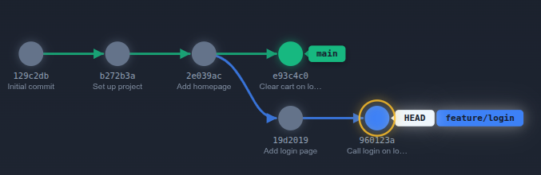
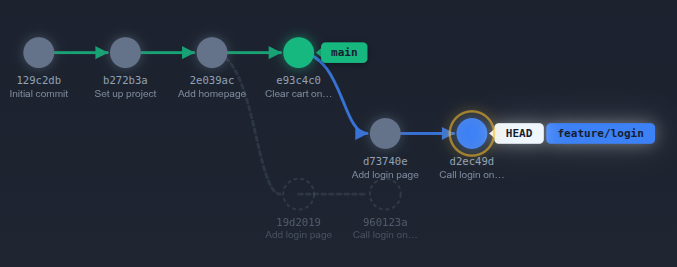

## 1. Architectural Foundations of Rebase in DevSecOps

Git rebase is an **active history rewriting engine**. Unlike `git merge`, which binds two histories together via a parent node, `git rebase` unplugs a sequence of commits, resets the working pointer to a new base commit, and **replays** those commits sequentially onto the new base.

1. Initial State: The Divergence (Divergent State Before Rebase):
When developing a feature concurrently with your team, branches naturally diverge. A developer creates `feature/login` from a shared base commit, while other engineers continue shipping changes (such as dependency updates or security hotfixes) directly into `main`.




#### What this diagram represents:
* **Common Ancestor (`2e039ac`)**: The last commit both branches share before diverging.
* **`main` has progressed**: It holds commits `e93c4c0` that `feature/login` does not have.
* **`feature/login` is out of date**: It was built against `2e039ac`, meaning it has not yet been validated against the newest baseline on `main`.


 2. The Rebase Command & Under-the-Hood Mechanics (Linear History):

To bring `feature/login` up to date without generating an extraneous merge commit, you run:

```bash
# Ensure your working directory is clean, then switch to the feature branch:
git checkout feature/login

# Rebase feature/login onto the latest main:
git rebase main
```
*(Alternatively, in a single command: `git rebase main feature/login`)*




> **The DevSecOps Golden Rule of Rebase:**  
> **Never rebase commits that have been pushed to a shared public branch** (such as `main` or `develop`). Rebase changes commit SHA-1 hashes. If other developers or CI/CD pipelines base their work on the original hashes, history diverges catastrophically, corrupting cryptographic audit trails. **Rebase locally, publish linearly.**

---

## 2. Lab Provisioning

Initialize a dedicated scratch workspace for all 4 scenarios:

```bash
# Clean up any previous runs
rm -rf /tmp/git-rebase-scenarios
mkdir -p /tmp/git-rebase-scenarios && cd /tmp/git-rebase-scenarios

# Initialize central repository
git init rebase-lab
cd rebase-lab

# Configure developer identity
git config user.name "devsecops-engineer"
git config user.email "engineer@lab.local"

# Initial commit on main
echo "# Secure Core API" > README.md
git add README.md
git commit -m "chore: initial repository baseline"
git branch -M main
```
Open two terminal panes: one for executing the lab commands, and another for inspecting the DAG with `watch -n 2 -c git log --oneline --graph --all --color --decorate`.

---

## 3. Scenario 1 : Forward-Porting a Diverged Feature Branch

### 3.1. Operational Context
A developer branches off `main` to build a user profile module. While they work, the team commits an essential security dependency update directly to `main`. The developer must forward-port their feature on top of the latest `main` commit without creating a noisy merge bubble.

---

### 3.2. Reproduction Steps

#### Step 1: Branch out and develop the feature
```bash
git checkout -b feature/user-profile

echo "def get_profile(): pass" > profile.py
git add profile.py
git commit -m "feat(profile): scaffold profile controller"

echo "def update_profile(): pass" >> profile.py
git add profile.py
git commit -m "feat(profile): implement profile update logic"
```

#### Step 2: Simulate upstream changes on `main`
```bash
git checkout main

echo "cryptography>=41.0.0" > requirements.txt
git add requirements.txt
git commit -m "security(deps): patch vulnerable cryptography library"
```

#### Step 3: Inspect history divergence
```bash
git log --oneline --graph --all
```

**Expected Visual DAG:**
```text
* 7f8a1b2 (HEAD -> main) security(deps): patch vulnerable cryptography library
| * 3c4d5e6 (feature/user-profile) feat(profile): implement profile update logic
| * 2b3c4d5 feat(profile): scaffold profile controller
|/  
* 1a2b3c4 chore: initial repository baseline
```

---

### 3.3. Rebase Execution & Verification

Switch to the feature branch and rebase it onto `main`:

```bash
git checkout feature/user-profile
git rebase main
```

**Expected Standard Output:**
```text
Successfully rebased and updated refs/heads/feature/user-profile.
```

Inspect the reconstructed graph:
```bash
git log --oneline --graph
```

**Audited Result:**
```text
* d5e6f7a (HEAD -> feature/user-profile) feat(profile): implement profile update logic
* c4d5e6f feat(profile): scaffold profile controller
* 7f8a1b2 (main) security(deps): patch vulnerable cryptography library
* 1a2b3c4 chore: initial repository baseline
```

> **DevSecOps Outcome:** Notice that the commit hashes for the profile feature changed (`3c4d5e6` -> `d5e6f7a`).

Merge the feature into `main` using Fast-Forward:
```bash
git checkout main
git merge --ff-only feature/user-profile
git branch -d feature/user-profile
```

---

## 4. Scenario 2 : Interactive Rebase (`-i`) for Hygiene & Secret Scrubbing

### 4.1. Operational Context
During rapid local development, an engineer makes multiple micro-commits containing messy commit messages and **accidentally commits an internal API key**. Before pushing to the remote server, the engineer must use `git rebase -i` to:
1. **Drop** the secret-bearing commit completely.
2. **Squash** messy exploratory commits into a clean, atomic Conventional Commit.
3. **Reword** the commit message to pass commit-linting policies.

---

### 4.2. Reproduction Steps

```bash
git checkout -b feature/payment-gateway

# Commit 1: Legitimate feature code
echo "class PaymentGateway: pass" > payment.py
git add payment.py
git commit -m "wip: start payment"

# Commit 2: ACCIDENTAL SECRET COMMITTED!
echo "STRIPE_SECRET_KEY=sk_live_9482019481029384" > .env
git add .env
git commit -m "leak: add secret key for local test"

# Commit 3: Typo fix
echo "# Production Stripe Connector" >> payment.py
git add payment.py
git commit -m "oops: fix comment typo"

# Commit 4: Additional logic
echo "    def charge(self): return True" >> payment.py
git add payment.py
git commit -m "fixup: finish charge method"
```

Inspect the polluted commit log:
```bash
git log --oneline -4
```
```text
* 16e7a87 (HEAD -> feature/payment-gateway) fixup: finish charge method
* bba8587 oops: fix comment typo
* 3dea103 leak: add secret key for local test
* 3f03a6c wip: start payment
* 0bef283 (main) feat(profile): implement profile update logic
* fc53a54 feat(profile): scaffold profile controller
* c5dac1f security(deps): patch vulnerable cryptography library
* 9274f81 chore: initial repository baseline
```

---

### 4.3. Interactive Rebase Execution

Target the last 4 commits:

```bash
git rebase -i HEAD~4
```

Git launches your default text editor with a script of instructions. Modify the commands to match the DevSecOps remediation plan:

```text
pick   <hash1> wip: start payment
drop   <hash2> leak: add secret key for local test
squash <hash3> oops: fix comment typo
squash <hash4> fixup: finish charge method
```

#### Meaning of Actions:
* `pick`: Retain the commit.
* `drop`: Completely purge the commit and its file modifications from the branch history.
* `squash`: Meld the commit into the previous commit (`pick`), combining their change payloads.

Save and close the editor. Git immediately opens a second prompt asking for the unified commit message for the squashed commits. Replace everything with a compliant, auditable commit message:

```text
feat(payment): implement Stripe gateway integration

- Add core PaymentGateway class
- Configure production payment charge method
- Fix documentation comments
```

```text
* 5b72d4f (HEAD -> feature/payment-gateway) feat(payment): implement Stripe gateway integrat
ion
* 0bef283 (main) feat(profile): implement profile update logic
* fc53a54 feat(profile): scaffold profile controller
* c5dac1f security(deps): patch vulnerable cryptography library
* 9274f81 chore: initial repository baseline

```

---

### 4.4. Security Audit & Integrity Check

Verify that `.env` is purged from history and code changes are consolidated into a single commit:

```bash
# 1. Verify commit log: Exactly one clean commit should remain
git log --oneline -2

# 2. Check if .env exists anywhere in the working directory or tracked tree
ls -la .env
git status
```

**Expected Verification:**
```bash
git log --oneline -2
# Output:
# a1b2c3d (HEAD -> feature/payment-gateway) feat(payment): implement Stripe gateway integration
# d5e6f7a (main) feat(profile): implement profile update logic

ls .env
# Output: ls: .env: No such file or directory
```

> **Security Win:** The leaked credential was erased **before** reaching any remote tracking branch, preventing credential harvesting by automated scrapers and removing the need for an emergency token revocation.

Promote changes to `main`:
```bash
git checkout main
git merge --ff-only feature/payment-gateway
git branch -d feature/payment-gateway
```

---

## 5. Scenario 3 : Multi-Stage Conflict Resolution & Abort Guardrails

### 5.1. Operational Context
Two teams alter the same production configuration file (`config.yaml`). Team A hardens authentication on `main`, while Team B adjusts timeout limits on a feature branch across two distinct commits. Rebasing triggers a **collision cascade** where each replayed commit conflicts with `main`.

---

### 5.2. Reproduction Steps

#### Step 1: Create the baseline configuration on `main`
```bash
cat << 'EOF' > config.yaml
server:
  host: 0.0.0.0
  port: 8080
  auth_mode: legacy
  timeout: 30
EOF

git add config.yaml
git commit -m "chore(config): add baseline application configuration"
```

```text
* dbd0d53 (HEAD -> main) chore(config): add baseline application configuration
* 5b72d4f feat(payment): implement Stripe gateway integration
* 0bef283 feat(profile): implement profile update logic
* fc53a54 feat(profile): scaffold profile controller
* c5dac1f security(deps): patch vulnerable cryptography library
* 9274f81 chore: initial repository baseline
```

#### Step 2: Team B forks and makes 2 changes on `feature/tuning`
```bash
git checkout -b feature/tuning

# Commit 1 on feature: Update timeout
sed -i 's/timeout: 30/timeout: 60/' config.yaml
git add config.yaml
git commit -m "perf(config): increase server timeout to 60s"

# Commit 2 on feature: Update host binding
sed -i 's/host: 0.0.0.0/host: 127.0.0.1/' config.yaml
git add config.yaml
git commit -m "sec(config): bind server strictly to localhost"
```

```text
* ea4a118 (HEAD -> feature/tuning) sec(config): bind server strictly to localhost
* 513c4e6 perf(config): increase server timeout to 60s
* dbd0d53 (main) chore(config): add baseline application configuration
* 5b72d4f feat(payment): implement Stripe gateway integration
* 0bef283 feat(profile): implement profile update logic
* fc53a54 feat(profile): scaffold profile controller
* c5dac1f security(deps): patch vulnerable cryptography library
* 9274f81 chore: initial repository baseline
```

#### Step 3: Team A commits security enforcement on `main`
```bash
git checkout main

# Team A modifies the exact same file
sed -i 's/auth_mode: legacy/auth_mode: mTLS/' config.yaml
sed -i 's/timeout: 30/timeout: 15/' config.yaml # Conflicts with Team B!
git add config.yaml
git commit -m "sec(config): enforce mTLS and reduce max idle timeout"
```

```text
* b050910 (HEAD -> main) sec(config): enforce mTLS and reduce max idle timeout
| * ea4a118 (feature/tuning) sec(config): bind server strictly to localhost
| * 513c4e6 perf(config): increase server timeout to 60s
|/
* dbd0d53 chore(config): add baseline application configuration
* 5b72d4f feat(payment): implement Stripe gateway integration
* 0bef283 feat(profile): implement profile update logic
* fc53a54 feat(profile): scaffold profile controller
* c5dac1f security(deps): patch vulnerable cryptography library
* 9274f81 chore: initial repository baseline
```
---

### 5.3. Rebase Conflict Handling

Switch to `feature/tuning` and start the rebase:

```bash
git checkout feature/tuning
git rebase main
```

**Conflict Trigger Output:**
```text
Auto-merging config.yaml
CONFLICT (content): Merge conflict in config.yaml
error: could not apply a1b2c3d... perf(config): increase server timeout to 60s
hint: Resolve all conflicts manually, mark them as resolved with
hint: "git add/rm <conflicted_files>", then run "git rebase --continue".
```

#### Step 4: DevSecOps Conflict Triage
Inspect the conflict markers:
```bash
git diff
```

**Conflict Output:**
```text
<<<<<<< HEAD (Version on main: Security Hardened)
  auth_mode: mTLS
  timeout: 15
=======
  auth_mode: legacy
  timeout: 60
>>>>>>> perf(config): increase server timeout to 60s
```

#### Arbitrated Resolution:
Security requirements take precedence over tuning (`auth_mode: mTLS`), but an operational compromise is agreed for timeout (`timeout: 45`):

```bash
cat << 'EOF' > config.yaml
server:
  host: 0.0.0.0
  port: 8080
  auth_mode: mTLS
  timeout: 45
EOF

# Stage the resolved conflict
git add config.yaml

# Resume rebase
git rebase --continue
```

Git will now apply the second commit (`sec(config): bind server strictly to localhost`). Because the file context was cleanly staged, Commit 2 applies automatically without further conflicts!

```text
Applying: perf(config): increase server timeout to 60s
Applying: sec(config): bind server strictly to localhost
Successfully rebased and updated refs/heads/feature/tuning.
```

---

### 5.4. Safety Check: How to Abort a Broken Rebase
If conflict resolution goes wrong, **do not panic or force-commit**. Run:
```bash
# Emergency escape hatch: cancels the rebase and restores exact pre-rebase state
git rebase --abort
```

Since our rebase succeeded cleanly, integrate the feature into `main`:
```bash
git checkout main
git merge --ff-only feature/tuning
git branch -d feature/tuning
```